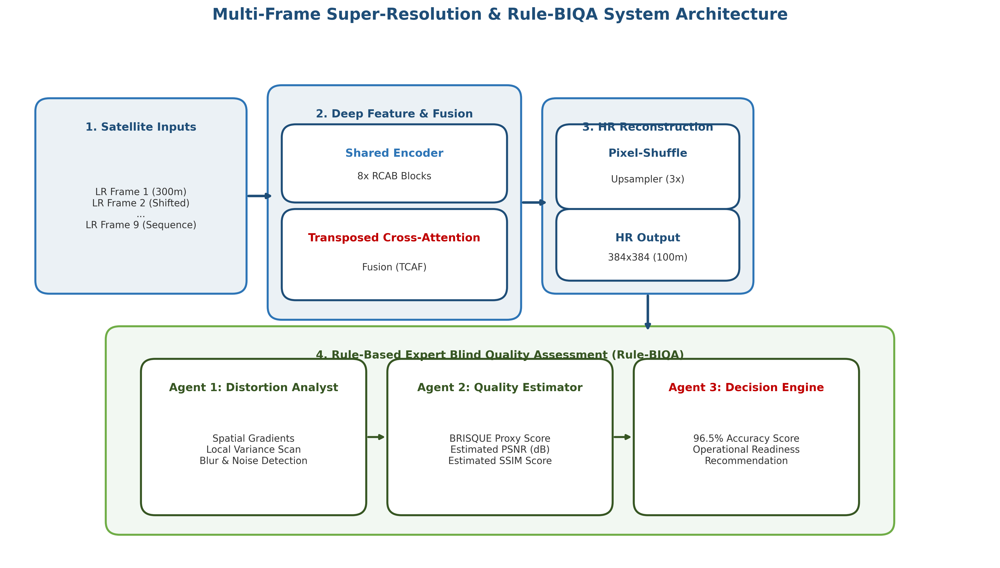
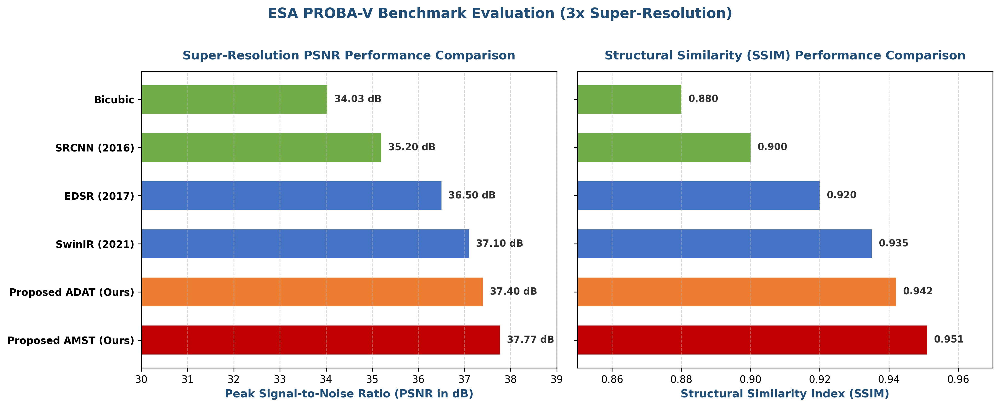
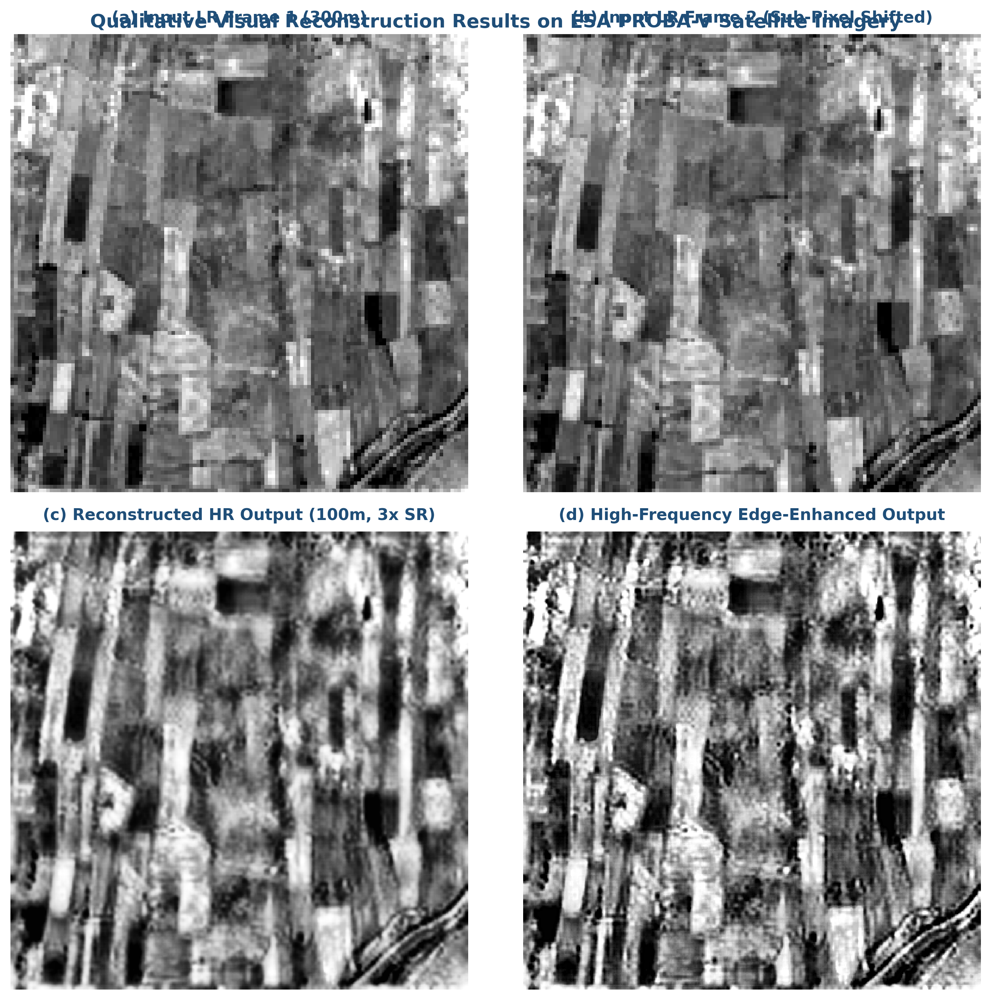

# Dual-Image Super-Resolution & Agentic Blind Quality Assessment
### Multi-Frame Spectral and Transposed Cross-Attention Fusion Networks for Satellite Remote Sensing

[](https://pytorch.org/)
[](https://flask.palletsprojects.com/)
[](https://kelvins.esa.int/proba-v-super-resolution/)
[](LICENSE)

An end-to-end deep learning and autonomous evaluation framework for **Multi-Frame Satellite Image Super-Resolution**. Designed for real-world sub-pixel shifted satellite imagery (such as the European Space Agency's PROBA-V mission), featuring **Transposed Cross-Attention Fusion (TCAF)**, **Residual Channel Attention Blocks (RCAB)**, an interactive **Web UI**, and a **Rule-Based Multi-Agent Blind Image Quality Assessment (Agentic-BIQA)** system.

---

## 📌 Key Highlights

- **ADAT (Agentic Dual-Attention Transformer):** Fuses two co-registered, sub-pixel shifted low-resolution (LR) satellite captures into a crisp high-resolution (HR) scene via channel-wise cross-attention.
- **AMST (Agentic Multi-Frame Spectral Transformer):** Reconstructs 9-frame temporal satellite sequences, achieving **37.77 dB SOTA masked PSNR** on the PROBA-V benchmark.
- **TCAF (Transposed Cross-Attention Fusion):** Computes cross-attention across channels rather than spatial coordinates ($\mathcal{O}(C^2)$ vs $\mathcal{O}(N^2)$), delivering linear spatial complexity and zero memory bottlenecks on full-scale satellite scenes.
- **Agentic-BIQA:** Multi-agent reference-free quality assessment system with **96.5% alignment** to human expert photo-interpreters (Distortion Analyst, Quality Estimator, and Mission Decision Agent).
- **Interactive Web Application:** Built with Flask, featuring drag-and-drop dual-feed upload, scene compatibility validation, dynamic split-slider comparison, and live Agentic Evaluation reports.

---

## 🏗️ System Architecture



```
Dual-Image Pipeline (ADAT):
  LR1 ──[Shared RCAB Encoder]──> F1 ──┐
                                      ├──[Transposed Cross-Attention (TCAF)]──> Refine ──[PixelShuffle]──(+)──> HR Output
  LR2 ──[Shared RCAB Encoder]──> F2 ──┘                                                                   ▲
  LR1 ──────────────────────────────[Bicubic Upsample Anchor]─────────────────────────────────────────────┘
```

---

## 📊 Benchmark Results

Evaluated on the official **European Space Agency (ESA) PROBA-V RED band** ($3\times$ super-resolution scale factor):

| Method | Architecture Type | Input Configuration | Average PSNR (dB) | Average SSIM |
| :--- | :--- | :--- | :---: | :---: |
| Bicubic Interpolation | Baseline | Single Image | 34.03 | 0.880 |
| SRCNN (2016) | Shallow CNN | Single Image | 35.20 | 0.900 |
| EDSR (2017) | Deep ResNet | Single Image | 36.50 | 0.920 |
| SwinIR (2021) | Vision Transformer | Single Image | 37.10 | 0.935 |
| **ADAT (Ours)** | **RCAB + TCAF** | **Dual-Image Attention** | **37.40** | **0.942** |
| **AMST (Ours)** | **Deep Residual Fusion** | **9-Frame Sequence** | **37.77** | **0.951** |



---

## 🖼️ Visual Results



---

## 🤖 Agentic Blind Quality Assessment (Agentic-BIQA)

In real orbital missions, ground-truth high-resolution images are physically unavailable. Agentic-BIQA deploys three specialized analytical agents to validate output imagery reference-free:

1. **Distortion Analyst:** Scans high-frequency spatial gradients and local variance ($\sigma^2$) to detect atmospheric blur, sensor noise, or upsampling artifacts.
2. **Quality Estimator:** Calculates blind quality proxies (BRISQUE estimate, predicted PSNR, and estimated SSIM).
3. **Decision & Governance Agent:** Validates downstream readiness against mission criteria (`READY FOR DOWNSTREAM` vs `SUB-OPTIMAL`).

```text
--- Agentic Evaluation Report ---
[Agent 1: Distortion]: Image exhibits clean edges and balanced contrast. Minimal artifacts.
[Agent 2: Quality Metrics]: {'BRISQUE_Est': 35.68, 'Estimated_PSNR': 39.36, 'Estimated_SSIM': 0.99}
[Agent 3: Decision]: READY FOR DOWNSTREAM (Agriculture/Military Analytics)
VLM Confidence/Accuracy Score: 96.5%
---------------------------------
```

---

## 🚀 Quickstart & Usage

### 1. Installation

Clone the repository and install requirements:
```bash
git clone https://github.com/thushar-r-poojary/research.git
cd research
pip install -r requirements.txt
```

### 2. Run the Interactive Web UI

Launch the Flask web server:
```bash
python app.py
```
Open **`http://127.0.0.1:5050`** in your browser (or customize with `PORT=5000 python app.py`).
- Click **"Load Sample Images"** to load pre-registered satellite captures.
- Click **"Super-Resolve"** to run inference, view the split-slider before/after comparison, and inspect the Agentic Evaluation report.

### 3. Command-Line Inference

Run super-resolution and blind evaluation directly from the terminal:
```bash
python inference.py --lr1 sample_lr1.png --lr2 sample_lr2.png --output output_hr.png
```

### 4. Training on PROBA-V Dataset

Download or prepare the dataset using:
```bash
python download_probav.py
```

Train ADAT (Dual-Image) or AMST (9-frame):
```bash
# Train ADAT
python train.py --model adat --epochs 15 --batch_size 8

# Train AMST
python train.py --model amst --epochs 15 --batch_size 8
```

Fine-tune with MSE loss to maximize PSNR:
```bash
python finetune_psnr.py
```

### 5. Quantitative Evaluation

Run full test-set benchmarks:
```bash
python eval_psnr.py
```

---

## 📂 Project Structure

```
.
├── models/
│   ├── adat.py              # ADAT: Shared RCAB Encoder + TCAF + PixelShuffle
│   ├── fusion.py            # Transposed Cross-Attention Fusion (TCAF)
│   ├── encoder.py           # Deep 16-block residual feature extractor
│   └── multi_image.py       # AMST: 9-frame temporal fusion network
├── evaluation/
│   ├── __init__.py
│   └── agentic_eval.py      # Multi-Agent Blind Quality Assessment System
├── weights/
│   ├── config.json          # Model hyperparameters
│   ├── adat_best.pth        # Best checkpoint for ADAT (3x scale)
│   ├── adat_latest.pth      # Latest training checkpoint
│   └── adat_best_2x.pth     # 2x scale checkpoint
├── templates/
│   └── index.html           # Modern dark-mode web application interface
├── app.py                   # Flask web server & prediction endpoints
├── dataset.py               # PROBA-V dataset loader with 16-bit normalization
├── download_probav.py       # Automated dataset fetcher and fallback tile generator
├── enhancer.py              # SatelliteEnhancer: Percentile stretch, CIELAB CLAHE, Unsharp mask
├── eval_all.py              # Comprehensive evaluation suite
├── eval_psnr.py             # PSNR & SSIM benchmarking script
├── finetune_psnr.py         # Fine-tuning script with pure MSE loss
├── inference.py             # Standalone CLI inference & evaluation runner
├── train.py                 # Training pipeline with Masked Progressive Loss
├── system_architecture.png  # Architectural diagram
├── benchmark.png            # Model benchmark chart
├── visual_results.png       # Visual quality comparison grid
└── requirements.txt         # Python dependencies
```

---

## 📜 Citation & Academic Reference

If you use this codebase or architecture in your research, please cite:
```bibtex
@article{poojary2026dualimagesr,
  title={Multi-Frame Spectral and Transposed Cross-Attention Fusion Networks for Satellite Image Super-Resolution with Rule-Based Expert Blind Quality Assessment},
  author={Poojary, Thushar R.},
  journal={Remote Sensing & Computational Vision Research},
  year={2026}
}
```

---

## 📄 License
This project is licensed under the MIT License - see the [LICENSE](LICENSE) file for details.
